<div align="center">


<sub>RESEARCH PAPER · IEEE CBMS 2024</sub>

<h1>Fully Automatic COVID-19 Detection on Chest CT</h1>

<p><b>FADCIL</b>: <b>F</b>ully <b>A</b>utomatic <b>D</b>etection of <b>C</b>ovid-19 cases in medical <b>I</b>mages of the <b>L</b>ung. Integrating YOLOv4 and 3D U-Net to diagnose COVID-19 and segment lung lesions in chest CT scans</p>

<sub>Jorge Valverde-Rebaza · Guilherme R. Andreis · Pedro Shiguihara · Sebastián Paucar · Leandro Y. Mano · Fabiana Góes · Julieta Noguez · Nathalia C. Da Silva</sub><br>
<sub><i>A Visibilia project, deployed with the Hospital das Clínicas of the University of São Paulo (HCFMUSP), Brazil</i></sub>

<a href="https://ieeexplore.ieee.org/document/10600915"></a>
<a href="https://doi.org/10.1109/CBMS61543.2024.00011"></a>


<a href="LICENSE"></a>

<br>

<table>
  <tr>
    <th colspan="3"><br>Two Networks, One Diagnosis<br><br></th>
  </tr>
  <tr>
    <td align="center" width="280"><br><sub>SEGMENTATION</sub><br><b>3D U-Net</b><br><sub>Low-resolution volumes · large lesions</sub><br><br></td>
    <td align="center" width="280"><br><sub>DETECTION</sub><br><b>YOLOv4 × 3</b><br><sub>Axial · coronal · sagittal · small lesions</sub><br><br></td>
    <td align="center" width="280"><br><sub>CLASSIFICATION</sub><br><b>XGBoost</b><br><sub>Lesion features → COVID-19 probability</sub><br><br></td>
  </tr>
  <tr>
    <td colspan="3" align="center">↓<br><br><b>Consensus-based COVID-19 Diagnosis</b><br><sub>Classification · Lesion segmentation · Lung impairment</sub><br><br></td>
  </tr>
</table>

<table>
  <tr>
    <td align="center" width="210"><h3>0.82+</h3><sub>DICE coefficient in a<br>real clinical setting</sub></td>
    <td align="center" width="210"><h3>1,000+</h3><sub>CT scans in the<br>evaluation dataset</sub></td>
    <td align="center" width="210"><h3>1,200+</h3><sub>automated diagnoses<br>during the pandemic</sub></td>
    <td align="center" width="210"><h3>10–20 s</h3><sub>to analyze<br>one CT scan</sub></td>
  </tr>
</table>

<sub>
<a href="#-at-a-glance">At a glance</a> ·
<a href="#-from-challenge-to-clinic">Timeline</a> ·
<a href="#-system-overview">System</a> ·
<a href="#-how-fadcil-reaches-a-diagnosis">Pipeline</a> ·
<a href="#-training-the-networks">Training</a> ·
<a href="#-videos">Videos</a> ·
<a href="#-in-the-news">In the news</a> ·
<a href="#-awards-and-recognition">Awards</a> ·
<a href="#-running-the-code">Running the code</a> ·
<a href="#-citation">Citation</a>
</sub>

</div>

<br>

## ◆ At a glance

When the COVID-19 pandemic hit, RT-PCR tests were essential but not always reliable, and **chest CT scans**, with a sensitivity of up to 95%, became a key diagnostic tool. Reading thousands of scans under pressure, however, overwhelmed radiology teams.

**FADCIL** is a deep learning framework that analyzes chest CT scans fully automatically. It segments the lungs, finds COVID-19 lesions at different stages, tells them apart from other pulmonary conditions, maps where they are and quantifies how much of the lung is affected. It combines two architectures that had been little explored for this task, **YOLOv4** and **3D U-Net**, enhanced through transfer learning, and runs in the cloud on GPUs with a processing queue to handle scans in real time.

> [!IMPORTANT]
> **TL;DR.** FADCIL was one of the winners of São Paulo's 2020 public challenge for AI-based COVID-19 diagnosis. Running alongside HCFMUSP, the largest hospital in Latin America, it delivered **1,200+ free automated diagnoses** to medical teams and reached a **DICE coefficient above 0.82** in a real clinical environment. The peer-reviewed method, evaluated on **more than 1,000 CT scans**, was published at IEEE CBMS 2024, and its source code is in this repository.

<br>

## ◆ From challenge to clinic

| When | Milestone |
| :--- | :-------- |
| **Apr 2020** | The São Paulo State Government and HCFMUSP launch [IdeiaGov Challenge nº 03/2020](https://ideiagov.sp.gov.br/desafios/diagnostico-atraves-de-imagens-de-tomografia-computadorizada-e-raio-x-de-torax/): *how can AI help radiologists diagnose COVID-19 from chest CT and X-ray?* |
| **Aug 2020** | FADCIL, by Visibilia, is selected as one of the winning solutions for CT scans. The result appears in the [Official Gazette of the State of São Paulo](https://www.imprensaoficial.com.br/DO/BuscaDO2001Documento_11_4.aspx?link=%2f2020%2fexecutivo%2520secao%2520i%2fagosto%2f15%2fpag_0028_0f4ec73d9ce98efebbb9ba398e36dc0e.pdf&pagina=28&data=15/08/2020&caderno=Executivo%20I&paginaordenacao=100028) on August 15, 2020 |
| **Sep – Dec 2020** | FADCIL is integrated with **RadVid-19**, HCFMUSP's platform collecting chest images from 50+ Brazilian hospitals. It delivers **1,200+ automated diagnoses free of charge**, supporting **1,100+ patients** |
| **Jun 2021** | FADCIL's contribution is featured in the Novartis Foundation's international case study *Pursuing AI maturity in health: How São Paulo, Brazil built an AI solution for diagnosing COVID-19* |
| **Jun 2024** | The method is published at the **IEEE 37th International Symposium on Computer-Based Medical Systems (CBMS 2024)**, and the source code is released |

<br>

## ◆ System overview

FADCIL reads CT scans in **DICOM, NII and NIfTI** formats and works on the axial, coronal and sagittal planes. It is organized into four modules:

<p align="center">
  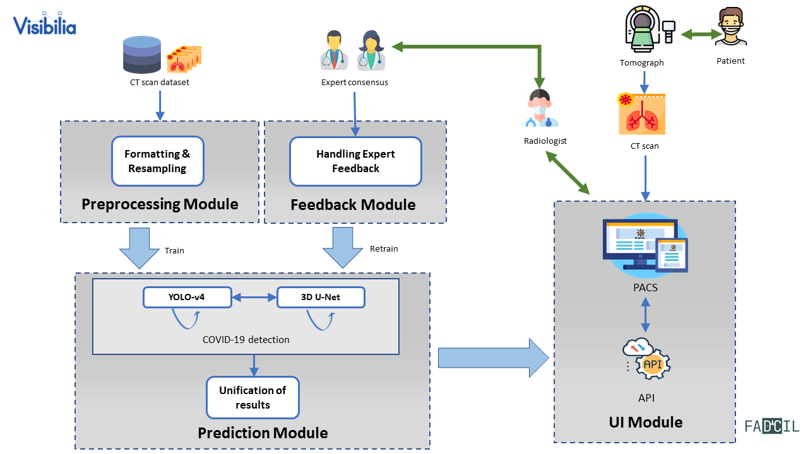<br>
  <sub><b>Modular architecture of FADCIL.</b> Preprocessing and feedback feed the prediction module, whose results reach radiologists through PACS via the FADCIL API.</sub>
</p>

<table>
  <tr>
    <td width="25%" valign="top"><b>Preprocessing</b><br><sub>Converts every scan to NIfTI and resamples it to a uniform voxel spacing, then derives low- and medium-resolution versions.</sub></td>
    <td width="25%" valign="top"><b>Prediction</b><br><sub>Combines 3D U-Net and YOLOv4 to detect, segment and classify COVID-19 lesions, then unifies their results.</sub></td>
    <td width="25%" valign="top"><b>User interface</b><br><sub>No UI of its own: integrates with PACS or other CT viewers through the FADCIL API, writing segmentations as new scans and results as structured reports.</sub></td>
    <td width="25%" valign="top"><b>Feedback</b> <sub>(optional)</sub><br><sub>Captures radiologists' feedback to refine and retrain the models over time.</sub></td>
  </tr>
</table>

<br>

## ◆ How FADCIL reaches a diagnosis

Every scan is first resampled to three resolutions, each serving a different network:

| Resolution | Voxel spacing | Used by |
| :--------- | :------------ | :------ |
| Uniform    | 0.75 × 0.75 × 0.8 mm | Reference for all further resampling |
| Low        | 3.0 × 3.0 × 3.2 mm   | 3D U-Net, fast screening for large lesions |
| Medium     | 1.5 × 1.5 × 1.6 mm   | YOLOv4 and 3D U-Net, fine analysis of small or uncertain cases |

<p align="center">
  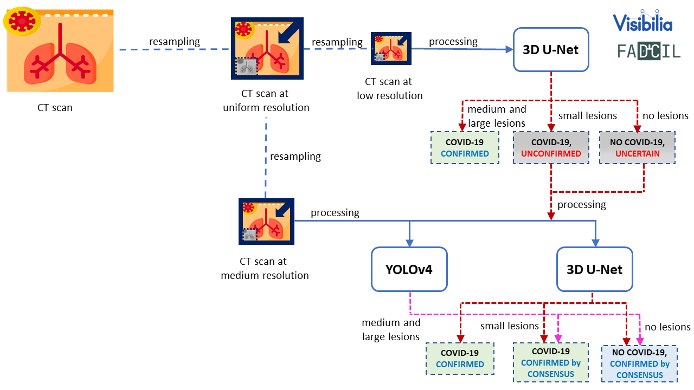<br>
  <sub><b>Integration of YOLOv4 and 3D U-Net in the prediction module.</b> Large lesions confirm COVID-19 directly. Small or absent lesions require the agreement of both networks.</sub>
</p>

| What 3D U-Net finds at low resolution | Next step | Final call |
| :------------------------------------ | :-------- | :--------- |
| Medium or large lesions | None | **COVID-19 confirmed** |
| Small lesions | YOLOv4 and 3D U-Net analyze the medium-resolution scan | **COVID-19 confirmed by consensus** |
| No lesions | YOLOv4 and 3D U-Net analyze the medium-resolution scan | **No COVID-19, confirmed by consensus** |

<details>
<summary><b>Step-by-step figures of the pipeline</b></summary>
<br>

<table>
  <tr>
    <td width="50%" align="center">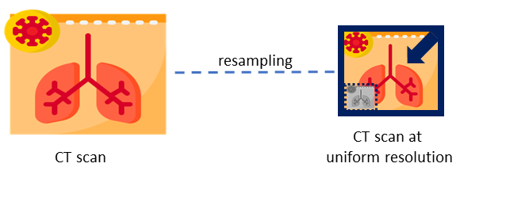<br><sub><b>1</b> · Resampling to a uniform resolution</sub></td>
    <td width="50%" align="center">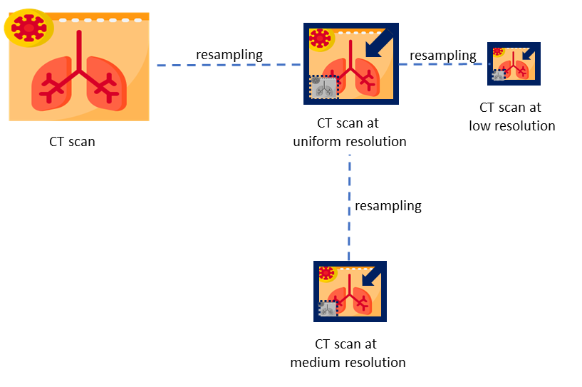<br><sub><b>2</b> · Deriving low- and medium-resolution scans</sub></td>
  </tr>
</table>

<p align="center">
  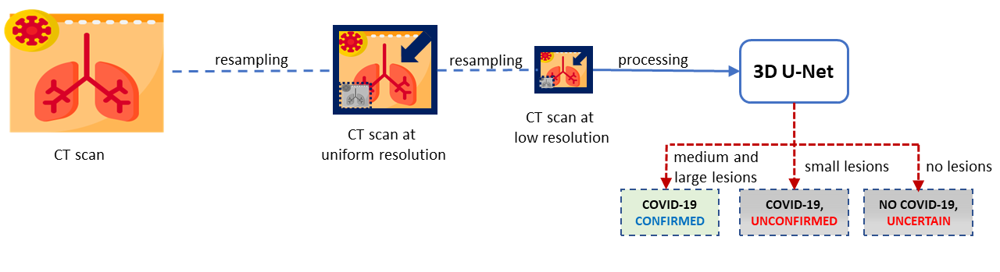<br>
  <sub><b>3</b> · 3D U-Net screens the low-resolution scan</sub>
</p>

<p align="center">
  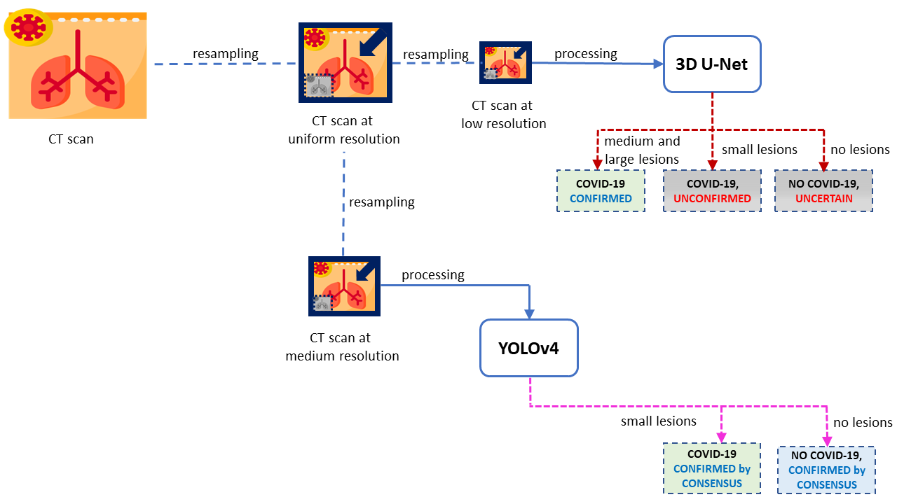<br>
  <sub><b>4</b> · YOLOv4 examines the medium-resolution scan for small lesions</sub>
</p>

</details>

<br>

## ◆ Training the networks

### YOLOv4 on three anatomical planes

YOLO works on 2D images, so FADCIL treats each CT scan as a stack of slices and trains **three YOLOv4 networks**, one per plane, with the [DarkNet](https://github.com/AlexeyAB/darknet) framework (about 20 hours of training). Their 2D bounding boxes are merged by region overlap into **3D regions** of COVID-19-related abnormalities.

| Network | mAP | Weight in *YOLOv4-3D weighted* |
| :------ | :-: | :----------------------------: |
| YOLOv4-Axial    | **0.714** | 0.40 |
| YOLOv4-Coronal  | 0.596     | 0.22 |
| YOLOv4-Sagittal | 0.693     | 0.38 |

Each network finds the lungs easily, but many slices hold no visible lesion, so a single network cannot decide alone. Two 3D combinations solve this: **YOLOv4-3D weighted** (weights above) and **YOLOv4-3D averaged** (equal weights). Keeping only regions where at least two of the three networks agree filters out false positives.

### 3D U-Net for segmentation

3D U-Net learns from expert annotations to capture fine detail in the volume. Because of its memory demands, each scan is split into patches, with mirroring at the borders, and the predictions are stitched back to the original size. To keep false positives low, a perfect Dice score of 1 is required when both the prediction and the reference show no lesions. Two networks were trained with Keras:

- **3D U-Net (COVID-19 only):** trained only on reference masks of COVID-19 cases.
- **3D U-Net (other cases):** trained on masks of other diseases and imaging findings, such as opacities.

### One unified model

After extensive testing, the four networks were combined with the following weights. Lesion sizes and categories from this unified configuration train an **XGBoost** classifier, selected with H2O AutoML, that outputs the probability of COVID-19. The final segmentation combines both 3D U-Nets.

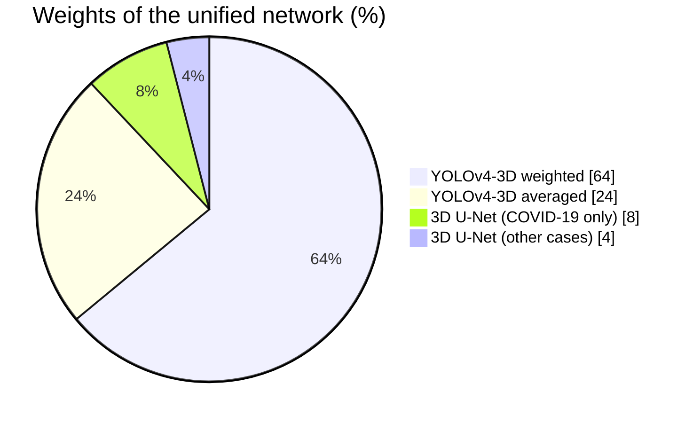

More details are available in the [published paper](#-citation).

<br>

## ◆ Videos

Short clips of FADCIL analyzing real chest CT scans, playing right here. Lungs are outlined in green and COVID-19 lesions in red. Click any clip to open the full-resolution video on YouTube.

<table>
  <tr>
    <td width="50%" align="center">
      <a href="https://www.youtube.com/watch?v=Z8YSy7dcKIU">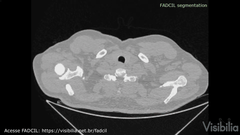</a><br>
      <b>AI diagnosis of COVID-19 on lung CT</b><br>
      <sub>Slice-by-slice segmentation of lungs and lesions · full video 0:19</sub>
    </td>
    <td width="50%" align="center">
      <a href="https://www.youtube.com/watch?v=C9yNXYsAQNo">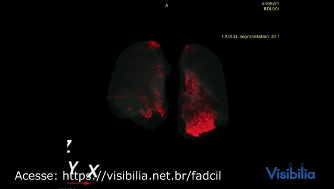</a><br>
      <b>COVID-19 lesions in 3D</b><br>
      <sub>Rotating 3D reconstruction of the affected lungs · full video 0:09</sub>
    </td>
  </tr>
  <tr>
    <td width="50%" align="center">
      <a href="https://www.youtube.com/watch?v=3UjsloUnRO8">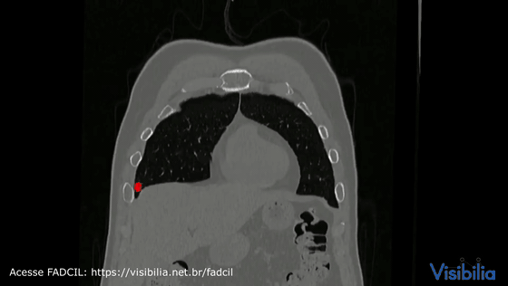</a><br>
      <b>Catching a small lesion</b><br>
      <sub>A single small focus detected in an otherwise clear lung · full video 0:07</sub>
    </td>
    <td width="50%" align="center">
      <a href="https://www.youtube.com/watch?v=W-NGyPA4xE0">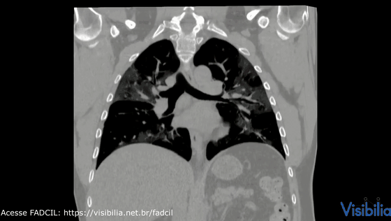</a><br>
      <b>Extensive bilateral involvement</b><br>
      <sub>Widespread lesions mapped across both lungs · full video 0:05</sub>
    </td>
  </tr>
</table>

<p align="center">
  <a href="https://www.youtube.com/playlist?list=PLxCzFuDeosTlrlphQ8-oZyMpYCLmMy4bA"></a>
  <a href="https://event.fourwaves.com/cbms2024/abstracts/a7c37654-93f1-439b-a5de-77e8f47ba45b"></a>
</p>

<br>

## ◆ In the news

<table>
  <tr>
    <td width="33%" valign="top">
      <a href="https://visibilia.net.br/visibilia-vence-concurso-covid19-fadcil-imagens-medicas/"></a><br>
      <sub>VISIBILIA · AUG 19, 2020</sub><br>
      <b><a href="https://visibilia.net.br/visibilia-vence-concurso-covid19-fadcil-imagens-medicas/">Visibilia develops AI to fight COVID-19 and wins international challenge</a></b><br>
      <sub>How FADCIL was selected in São Paulo's public call 03/2020, which drew 19 participating institutions, and why its CT analysis takes only seconds.</sub>
    </td>
    <td width="33%" valign="top">
      <a href="https://www.icmc.usp.br/noticias/5040-sistema-inteligente-capaz-de-identificar-tomografias-com-sinais-de-covid-19-e-selecionado-em-desafio-internacional"></a><br>
      <sub>ICMC · UNIVERSITY OF SÃO PAULO · SEP 17, 2020</sub><br>
      <b><a href="https://www.icmc.usp.br/noticias/5040-sistema-inteligente-capaz-de-identificar-tomografias-com-sinais-de-covid-19-e-selecionado-em-desafio-internacional">Intelligent system that identifies CT scans with signs of COVID-19 is selected in international challenge</a></b><br>
      <sub>The story of the ICMC alumni behind FADCIL, and how training on varied anatomy makes it robust across patients.</sub>
    </td>
    <td width="33%" valign="top">
      <a href="https://visibilia.net.br/ia-da-visibilia-contribui-em-estudo-de-caso-internacional/"></a><br>
      <sub>VISIBILIA · JUN 21, 2021</sub><br>
      <b><a href="https://visibilia.net.br/ia-da-visibilia-contribui-em-estudo-de-caso-internacional/">Visibilia's AI contributes to an international case study</a></b><br>
      <sub>One year on: 1,200+ free automated diagnoses for HCFMUSP and São Paulo hospitals, and a Novartis Foundation case study on the initiative.</sub>
    </td>
  </tr>
</table>

<sub>Articles in Portuguese. More coverage on the <a href="https://visibilia.net.br/category/fadcil/">Visibilia blog</a>.</sub>

<br>

## ◆ Awards and recognition

- **Winner, IdeiaGov Challenge nº 03/2020.** Launched by the São Paulo State Government to find AI solutions that help radiologists diagnose COVID-19 from CT and X-ray images. After a rigorous evaluation, Visibilia was selected as a winner, as officially published in the [Official Gazette of the State of São Paulo](https://www.imprensaoficial.com.br/DO/BuscaDO2001Documento_11_4.aspx?link=%2f2020%2fexecutivo%2520secao%2520i%2fagosto%2f15%2fpag_0028_0f4ec73d9ce98efebbb9ba398e36dc0e.pdf&pagina=28&data=15/08/2020&caderno=Executivo%20I&paginaordenacao=100028) on August 15, 2020.
- **International case study.** FADCIL's real-world contribution is part of the Novartis Foundation's 2021 case study on how São Paulo built an AI solution for diagnosing COVID-19.

<br>

## ◆ Running the code

The source code is written in **Python** and **R**.

| File | Description |
| :--- | :---------- |
| [`unet3D_keras_segmentation.py`](unet3D_keras_segmentation.py) | 3D U-Net model (Keras / TensorFlow) that segments the lungs and COVID-19 lesions |
| [`yolov4-covid_classification.cfg`](yolov4-covid_classification.cfg) | DarkNet configuration of the YOLOv4 networks |
| [`final-classification.R`](final-classification.R) | Classifier (H2O AutoML, XGBoost) that computes the probability of COVID-19 from the extracted features |
| [`requirements.txt`](requirements.txt) | Python dependencies |
| [`requirements-R.txt`](requirements-R.txt) | R and system dependencies: Java 8 (64-bit JDK), R 3 or later, H2O 3.32.0.2, dplyr 1.0.2, tidyverse 1.3.0 |
| [`images/`](images) | Architecture and pipeline figures |

### 1. Set up the environment

Install the Python packages:

```bash
pip install -r requirements.txt
```

Then install the R packages and other software listed in `requirements-R.txt`.

### 2. Execute the scripts

- **Segmentation:** run `unet3D_keras_segmentation.py` to segment the lungs and detect COVID-19 lesions in CT scans.
- **Classification:** run `final-classification.R` to compute the probability of COVID-19 from the features extracted by the segmentation step.
- **Configuration:** make sure `yolov4-covid_classification.cfg` holds the right parameter values for the deep networks used in the segmentation step.

### 3. Expected outputs

- **Binary classification:** label **1** (COVID-19) or **0** (not COVID-19), together with a probability score.
- **Segmentation:** a binary mask marking the position of the lesions.

### Additional tasks

- **Input reading:** implement the code needed to read CT scans in DICOM, NII or NIfTI format.
- **Pre-processing** *(optional)*: add code to clean or prepare the data for your requirements.
- **Post-processing** *(optional)*: adjust the results to specific formats or specifications.
- **Visualization** *(optional)*: add code to display the results graphically.

> [!WARNING]
> **Caution.** The results generated by FADCIL must not be used directly in clinical settings without appropriate validation and approval by medical professionals.

<br>

## ◆ Commercial version

Visibilia offers a commercial version of FADCIL, enhanced for clinical use. It adds a low refusal rate, high-speed processing, DICOM structured report files and secure integration with existing clinical platforms. Learn more on the [FADCIL product page](https://visibilia.net.br/fadcil).

<p align="center">
  <a href="https://visibilia.net.br/fadcil"></a>
</p>

<br>


## ◆ Citation

<div align="center">

<a href="https://ieeexplore.ieee.org/document/10600915"></a>
<a href="https://www.researchgate.net/publication/381767923_Integrating_YOLO_and_3D_U-Net_for_COVID-19_Diagnosis_on_Chest_CT_Scans"></a>
<a href="https://doi.org/10.1109/CBMS61543.2024.00011"></a>

</div>

If you use FADCIL in your research, please cite our paper:

> Valverde-Rebaza, J., Andreis, G. R., Shiguihara, P., Paucar, S., Mano, L. Y., Góes, F., Noguez, J., & Da Silva, N. C. (2024). Integrating YOLO and 3D U-Net for COVID-19 diagnosis on chest CT scans. In *Proceedings of the IEEE 37th International Symposium on Computer-Based Medical Systems (CBMS 2024)* (pp. 15–20). IEEE. https://doi.org/10.1109/CBMS61543.2024.00011

```bibtex
@inproceedings{valverde:fadcil:cbms24,
  title     = {Integrating {YOLO} and {3D U-Net} for {COVID-19} Diagnosis on Chest {CT} Scans},
  author    = {Valverde-Rebaza, Jorge and Andreis, Guilherme R. and Shiguihara, Pedro and Paucar, Sebasti{\'a}n and Mano, Leandro Y. and G{\'o}es, Fabiana and Noguez, Julieta and Da Silva, Nathalia C.},
  booktitle = {Proceedings of the IEEE 37th International Symposium on Computer-Based Medical Systems},
  series    = {CBMS 2024},
  pages     = {15--20},
  year      = {2024},
  publisher = {IEEE},
  doi       = {10.1109/CBMS61543.2024.00011},
  url       = {https://ieeexplore.ieee.org/document/10600915}
}
```

<br>

---

<div align="center">
<sub>
Copyright (C) 2020-2024 <a href="https://visibilia.net.br">Visibilia</a> · Code released under the <a href="LICENSE">MIT License</a><br>
FADCIL is a product of Visibilia Ltda.
</sub>
</div>
